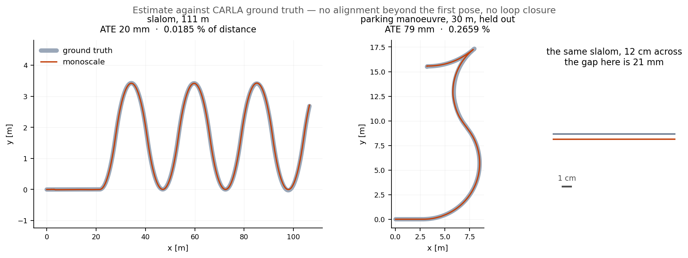
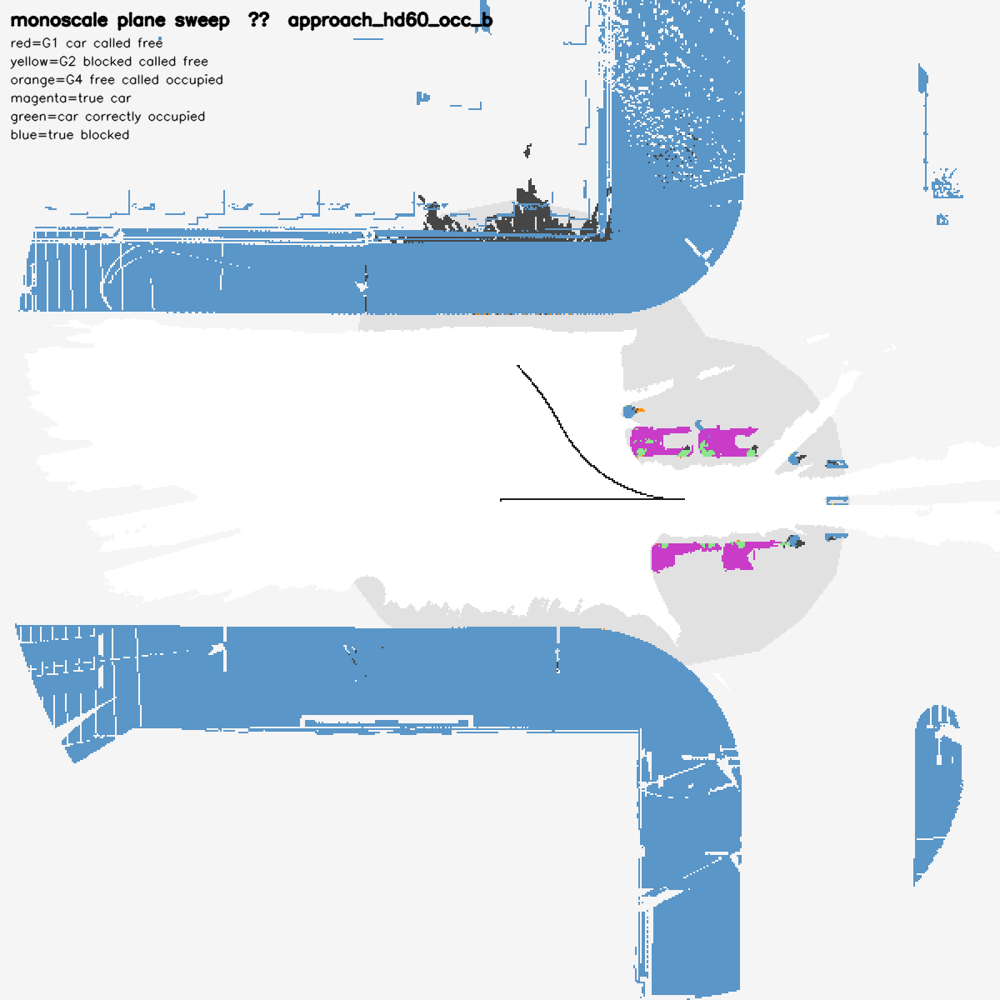

# monoscale

[](LICENSE)
[](https://docs.ros.org/en/humble/)
[](src/monoscale_core)
[](#tests)

**monoscale** turns ordinary monocular cameras into a **metric** odometry and
occupancy stack, taking its scale from the one distance a road vehicle already
knows: **the height of the camera above the road**.

No stereo pair, no lidar in the loop, no learned model, no prior map, no wheel
encoder. One camera is enough, N is allowed, and they are free not to overlap --
the two on this vehicle face opposite ways and share no field of view at all.



> The CARLA slalom and the held-out park manoeuvre. At the scale of the drive
> the two lines are one; the right-hand panel zooms until the gap is visible and
> puts a scale bar beside it, because a figure where nothing can be seen proves
> nothing. Regenerate with `monoscale_evaluation/plot_trajectories.py
> <slalom_dir> <park_dir> <out.png>` from any pair of `--tum` outputs.

**Where it is meant to run.** Where GNSS does not reach and the vehicle is
moving slowly -- indoor parking structures, loading yards, the last thirty
metres of an automated park. The rig is the surround-view configuration a
production car already carries, so **nothing has to be added to the vehicle to
make those cameras metric**. The accuracy goes as camera height over distance
travelled per frame, so low and slow is the regime it is best in, which is the
opposite of what a stereo baseline prefers.

---

## Results

Measured in two places, far enough apart that one number would misdescribe
both. Same code and same definitions throughout
(`monoscale_evaluation/benchmark.py`), tuned figure first, held-out second:

| | CARLA, 29-150 m | Ford Multi-AV, 5.2 km |
| --- | ---: | ---: |
| **ATE / distance** | **0.0237 %** / **0.1781 %** | 0.451 % / **0.182 %** |
| final error / distance | 0.0324 % / 0.2659 % | 0.519 % / **0.097 %** |
| `hop %` — what one observation is worth | 0.14 / 0.83 | 3.24 / 3.48 |
| `walk` — accumulation over a random walk | 1.10 / 0.76 | 5.07 / **1.15** |
| road read at a depression angle of | 25.1 deg | 7.0 deg |

In millimetres, because a percentage of distance is hard to feel: **26 mm of ATE
over a 111 m simulated drive**, and **9.5 m over a 5.2 km real one** that ends
5.1 m from where the vehicle ended up.

Neither number is the other's failure. The bottom row is most of why they
differ, and [what sets the precision](#what-sets-the-precision) is that
argument. What transferred from the simulator to the vehicle is `walk` --
accumulation, the hard half of odometry -- at 1.15 held out against 1.10 and
0.76. What did not is `hop %`, the worth of a single ground observation.

**Read the held-out column.** In CARLA two parking drives are kept out of every
sweep and every judgement, and they earn it: in one week they refused four
changes that had won on the tuning set, including the removal of the last fitted
multiplier in the stack. On Ford, Log6 plays the same part and no parameter was
ever chosen against it. Numbers, the set they come from and how to reproduce
them are in
[`src/monoscale_evaluation/README.md`](src/monoscale_evaluation/README.md); the
Ford harness lives in the untracked `tools/`, so those two figures are recorded
here rather than reproducible from a clone.

---

## Why scale from the ground plane

Monocular vision has no scale. Every source of it trades away something:

| Scale source | No extra hardware | Works at a standstill | Metric from frame 1 | Unaffected by texture | Needs no prior map |
|---|:--:|:--:|:--:|:--:|:--:|
| Stereo baseline | ✗ | ◎ | ◎ | ○ | ◎ |
| Lidar | ✗ | ◎ | ◎ | ◎ | ◎ |
| IMU-only excitation | ◎ | ✗ | ✗ | ◎ | ◎ |
| Learned monocular depth | ◎ | ◎ | ○ | △ | ◎ |
| Prior map / HD map | ◎ | ◎ | ◎ | ○ | ✗ |
| **Ground plane (this)** | **◎** | **◎** | **◎** | **△** | **◎** |

◎ strong · ○ workable · △ limited · ✗ not supported

A stereo pair or a lidar is hardware the vehicle may not have. An IMU observes
scale only when it is excited, which is exactly not the parking case. Learned
depth is metric only as far as its training distribution reaches. A prior map is
the thing you were trying to build. The ground plane asks for none of that: a
plane-induced homography between two frames recovers `t/h`, and `h` is the
mounting height, so the answer is metric without anything else in the vehicle
measuring length. What it does ask for is **texture on the road**, and that is
the one column where it is weak -- see [what sets the
precision](#what-sets-the-precision).

---

## Key properties

* Metric scale from the mounting height alone -- no baseline, no range sensor
* Cameras need not overlap; on this rig they cannot (40.53 deg of gap per side)
* One camera is a supported rig, not a degenerate case -- costs 2.6 to 6.2x
* Any N cameras; each contributes its own ground observation and anchor map
* Heading self-contained: gyro-integrated, its bias corrected by the road fit
* Dead reckoning through a failed solve follows the gyro's arc, not the tangent
* An anchor map of ground sightings bounds the random walk over 1600 frames
* Occupancy from the same images by plane sweep, CUDA for real time
* Estimator core knows nothing of ROS and is tested without a graph
* 149 tests; every deployed constant carries the measurement that chose it

---

## How it works (high level)

1. A KLT front end turns each image into feature tracks and publishes those
   alone, so the estimator never sees a frame.
2. Tracked pixels inside a distance band are projected onto the assumed road
   plane, using the mounting height and the camera's tilt against the road.
3. Each correspondence votes for one translation; the hop is a robust mean of
   those votes, with the heading handed in from the gyro.
4. A photometric alignment of the road region measures the same hop a second
   way, from texture rather than from features, and is blended in.
5. Ground sightings are written into an anchor map in world coordinates; where
   it can answer, the hop becomes a pose correction against it rather than a
   two-frame increment, which is what bounds the random walk.
6. The cameras' answers are combined, equalised, and filtered with the
   accelerometer as a prediction.
7. Separately, the raw frames are plane-swept into an occupancy grid using the
   attitude this odometry publishes.

---

## What sets the precision

This is the part worth reading before trusting a number, because the two
columns above differ by 67x in `hop %` and the reason is almost entirely
**geometry and registration, not code**.

The projection has exactly two parameters -- the camera's perpendicular
distance to the road and the plane's normal -- so every range out of it is
`lambda = -h / (ray . n)`. A displacement common to the whole tracked patch is
therefore indistinguishable from motion: the fit absorbs it into the
translation, and no observable downstream can see it. Measured on Ford, that
common part is **98 %** of the hop length error, and the hop length is **85 to
89 %** of the segment error. The individual points agree with each other to 1.5
to 2.0 pixels and averaging them would give 1.4 to 1.8 % of the hop -- the
floor the scoring assumes. The hop is wrong by nine times that.

Decomposing it against the simulated rig, the arithmetic closes to one per cent:

| | CARLA | Ford | ratio |
| --- | ---: | ---: | ---: |
| hop | 0.123 m | 1.980 m | 16.0x *in Ford's favour* |
| mean range of the band | 1.9 m | 13.0 m | |
| **depression angle** | **25.1 deg** | **7.0 deg** | `R/h` 2.1 against 8.2 |
| cost per pixel, `(R²+h²)/(h·f)` | 0.0047 m | 0.1140 m | **24.4x** |
| implied collective registration bias | **0.059 px** | **2.578 px** | **43.8x** |
| common part, as a fraction of the hop | 0.22 % | 14.84 % | 67x |

`24.4 x 43.8 / 16.0 = 66.6` against 67.5 measured.

**The governing quantity is the depression angle at which the road is read**,
because the per-pixel cost goes as `(R/h)²` and `R/h = 1/tan(theta)`. Precision
therefore goes as `tan²(theta)`, and `(tan 25.1 / tan 7.0)² = 14.6` -- most of
the 24.4x. The same angle degrades the other factor too: one metre of road
along the line of sight is **212.5 pixels** at 25.1 deg and **8.8** at 7.0, so a
10 cm road feature spans 0.88 of a pixel and the instrument is read at its
sampling limit. Motion blur lands in the same place -- 0.6 to 1.2 px at 14 m/s
for a 5 to 10 ms exposure, against the 2.58 px measured.

It is not the plane's attitude, and that is a budget argument rather than a
guess. The vehicle rides the road, so the body's pitch and the road's slope move
together (correlated 0.96 and 0.92 against truth); the camera-to-road angle,
the only angle this projection wants, varies by just 0.243 and 0.363 deg rms.
At the tilt-to-hop gain of `2R/h` that is at most 6.9 and 10.3 % of a hop
against 13 to 14 measured, so failing to follow that angle completely would
still leave most of the error. A height error would need 23 cm.

So the lever is mounting. Pulling the near edge of the band in raises the
depression angle, and on this vehicle it is where the bodywork is: the held-out
drive reads 2.20 % at 6.0 m, 2.29 % at 5.5 and 3.19 % at 5.0, and the front's
hop noise *rises* on the way in, which is the signature of new bad points rather
than better geometry. Trimming the far edge instead trades amplification against
conditioning and loses. **A camera that cannot read the road inside twenty
degrees is short of geometry, not of tuning.**

---

## What it assumes

* **The road under the cameras is locally planar.** The homography is
  plane-induced, so a surface that is not a plane is model error the
  four-parameter fit must absorb. On these roads it holds to under a millimetre
  over a hundred metres. A crest, a rut or a steep camber would break it first.
* **The mounting height is right to a millimetre.** Scale is `t/h`, so a
  relative error in `h` is the same relative error in every distance --
  correcting one millimetre of it halved the benchmark. Ride height moves with
  load, tyre pressure and suspension travel.
* **The road has texture.** It is the instrument. Changing CARLA's quality level
  alone moves the length bias by a factor of sixty.
* **The sensors are cameras and an IMU, and nothing else.** A pose solution is
  refused even when the recording offers one. One qualification, because the top
  of this file should not be read as stronger than it is: the running system
  reads two image streams and an IMU, but the number that says where one of
  Ford's cameras *points* came from that vehicle's lidars. Over a 6-30 m band a
  height error and a tilt error leave residuals whose bases correlate 0.987, so
  the images see the slope -- the pair solve's radial residual crosses zero at
  0.153 degrees, the same angle -- and cannot say which of the two it is. What
  the lidar supplied is the attribution, not the measurement, and that is the
  whole of its role.

---

## What has not been tested

* **A noisy IMU.** CARLA's carries zero noise on every axis -- accelerometer,
  gyro and gyro bias all 0.0 -- so the attitude filter, the heading and the
  inertial propagation have never met angle random walk. Ford's is real, but
  Log5 arrives with 88309 all-zero orientation quaternions and is scored as a
  level vehicle; that costs a measured 0.08 pp.
* **A third drive.** Two CARLA park manoeuvres and one Ford log are the whole
  held-out evidence. Every change tried in one recent session moved the two Ford
  drives in opposite directions, and there is no witness to adjudicate.
* **A low mount.** Every real-vehicle figure here comes from a roof camera
  reading the road at 7 degrees. The central claim above predicts a large gain
  from a bumper or mirror mount, and nothing has measured it.
* **Rear-equipped public benchmarks.** KITTI cannot stand in: it has no rear
  camera at all, and putting Ford in the same condition accounts for most of the
  gap between the two columns.
* **Weather, night, wet asphalt.** One town, one weather, one sun angle.

---

## Limitations

`monoscale` is a ground-plane odometry stack with a deliberately scoped model:

* planar road only -- no vertical-curvature model, no camber estimate
* scale is only as good as the mounting height, which is an input
* precision goes as `tan²` of the depression angle, so a high mount is expensive
* texture-dependent -- smooth concrete and standing water are failure cases
* calibration is fragile: perturbing the mount pitch by 0.004 degrees, a
  fortieth of the correction this vehicle needed, swings ATE by tens of per
  cent, while the same vehicle's pitch moved 0.154 degrees over three months
* about 0.6 % of residual scale is a rig constant worth 0.96 cm of camera
  height that lidar, accelerometer and truth trajectory each fail to determine
* the occupancy grid needs CUDA for real time
* **a research stack measured on one simulator and one vehicle -- not a
  product, and not a localisation system you should put a person behind**

The reasoning behind each, and the measurements that rejected the alternatives,
are in the configuration's own comments; see [how it is
built](#how-it-is-built).

---

## Number of cameras

With the disagreement between two cameras gone, `single_camera_variance`
carries that weight instead. It solves every drive in both sets:

| | bench mean / worst | held-out mean / worst |
| --- | ---: | ---: |
| front + rear | 0.0237 % / 0.0391 % | 0.1781 % / 0.2659 % |
| front only | 0.0621 % / 0.1265 % | 0.5689 % / 1.0588 % |
| rear only | 0.1474 % / 0.4529 % | 0.5694 % / 0.7701 % |

So one camera costs a factor of 2.6 to 6.2 and does not fall over, and the
front mount -- the lower one, which sees the ground it is about to drive over --
is the better of the two to keep. A unit test holds the floor:
`EstimatorDrive.OneCameraIsARigNotADegenerateCase`. What must not happen is that
it silently stops solving.

The second camera's value is mostly not its vote. On Ford, muting it to a
weight of 1e-6 costs 0.1 pp while removing it entirely costs 1.4; the rest is
the anchor map it co-builds and the error shape it contributes unweighted.

---

## How it is built

Every constant in `vision_fisheye.param.yaml` carries the measurement that chose
it, and the measurements that rejected the alternatives. That is why the config
is 90 % comment: a value without its evidence is a value nobody can change
safely later. Ideas that were tried and lost are recorded with their numbers so
they are not tried again, and several of them were mine.

Two rules do most of the work. **Measure the quantity, do not fit the score** --
the scale correction that reads 0.1 % is derived from a millimetre of frame
geometry, not swept against ATE. And **held-out decides** -- a change that wins
on the bench and loses on the two park drives is an artefact of the bench.

Everything that runs on the vehicle is C++. The stack was developed against a
Python estimator, which was removed from the tree once the trajectories matched;
what was carried across and what was not is in
[`src/monoscale_core/README.md`](src/monoscale_core/README.md).
---

## Packages

| package | what it does |
| --- | --- |
| `monoscale_core` | the estimation itself. Knows nothing of ROS, so it is tested without a graph and can later share a process with a controller. |
| `monoscale_tracker` | the C++ KLT front end. Turns images into feature tracks and publishes those alone. |
| `monoscale_odometry` | the node around it, and `monoscale_replay`, which scores a bag directly. |
| `monoscale_occupancy_grid_map` | plane-sweeps the raw fisheye into an occupancy grid. CUDA for real time. |
| `monoscale_evaluation` | scoring against truth. Not deployed. |
| `monoscale_carla` | CARLA only: camera assembly, the truth tap, the drive scripts. |
---

## Topics

```
images ─┬─→ monoscale_tracker  →  /vision/tracks/<camera>
        │                          └→ monoscale_odometry
        │                                 ├→ /localization/kinematic_state
        │                                 └→ /perception/ground_points
        └────────────────────────→ monoscale_occupancy_grid_map
                  + camera_info               └→ /perception/occupancy_grid_map
                  + /localization/kinematic_state
```

The two branches split at the image. Odometry sees only feature tracks; the grid
looks at the raw frames again.

The grid is a **plane sweep**: world-horizontal planes are stacked from −0.15 m
in 0.05 m steps, each pixel is scored by ZNCC for how well two views agree at
each height, and SGM aggregates that into the surface height for that pixel. The
height is therefore a decision, not a by-product of triangulating features.
Attitude comes straight out of the subscribed odometry and enters the per-pixel
warp.

An earlier version accumulated the odometry's `/perception/ground_points` into
the grid. That topic is still published and the grid no longer uses it: an
obstacle that yields no corners never existed on that path, and an audit of the
depth chain found five defects, the largest of which was the warp holding pitch
and roll at zero -- 94 % of the frame-common error.

The grid is a fixed 60 x 60 m at 0.1 m, anchored to the first pose. Scored
against truth on `approach_hd60_occ_b`: G1 (calling the vehicle free) 0, G2
(calling blocked ground free) 3, G3 (cover) 0.831, G4 (false positives) 29, path
ghosts 0. A Python reference under the same conditions gives G2 2 / G3 0.829 /
G4 39, so cover and false positives are ahead here.



Four numbers are not a map, so here is the map they are scored over. White is
ground the sweep carved free, dark grey is what it called occupied, blue is
ground that truly is blocked and pale grey is never observed; the parked cars
are magenta and the parts of them the sweep found are green. The three failure
predicates have their own colours, and what the scores above say is that **there
is no red at all** -- not one cell of a vehicle was called free -- with three
yellow cells and a thin orange rim. Regenerate it with
`monoscale_evaluation/render_map.py`; the truth archives it scores against are
too large to ship, and `sim/` is what makes them.
---

## Building and running

```bash
source /opt/ros/humble/setup.bash
colcon build --base-paths src --symlink-install
source install/setup.bash

ros2 launch monoscale_odometry odometry.launch.py
```

Odometry needs no CUDA. `monoscale_tracker` has a GPU path for the optical flow
(`use_cuda`), built only when an OpenCV with cudaoptflow is found, and off by
default.

**The occupancy grid does need it.** The CPU sweep takes 28 minutes over 674
keyframes and cannot ship; the CUDA path takes **34 ms** per keyframe, both
cameras counted, with the card 95 % busy. The kernel is
`src/monoscale_occupancy_grid_map/src/sweep_kernels.cu` and CMake compiles it
when `nvcc` is present. Without `nvcc` the build falls back to the CPU path,
so a successful build is not a deployable one -- check the first run for
`cuda backend: available=1`.

Until 2026-09-18 that fallback did not exist: `cuda_match` was declared
unconditionally and defined only in the CUDA translation unit, so a machine
without `nvcc` failed at the link rather than falling back. It went unseen
because this machine's CMake finds `/usr/local/cuda` whether or not `nvcc` is
on PATH; a build of a tree made only of the tracked files is what surfaced it.
---

## Tests

```bash
colcon test
colcon test-result --all
```

148 of them: the geometry, the anchor map, the filters, the inertial path, the
attitude, the estimator end to end over a synthetic drive, and two that hold the
vehicle's frame tree against the simulator's own calibration.
---

## Scoring against a recorded drive

```bash
ros2 run monoscale_odometry monoscale_replay <bag> \
  --params src/monoscale_odometry/config/vision_fisheye.param.yaml \
  --set track_topic_prefix:=/vision/tracks
```

It reads the bag itself and drives the library in recording order. It reads no
clock and no random source, so one bag gives one trajectory on a desktop and on
an Orin alike -- which is why regressions are visible at all.
---

## Reproducing the recordings

[`sim/`](sim/README.md) carries the conditions the bags were recorded under: the
sensor kit the odometry's extrinsics are derived from, the sensor mapping, and
the drive scripts. It is there because a millimetre of mounting height moves the
result by 0.1 %, so the calibration and the config that depends on it have to
move in one commit.
